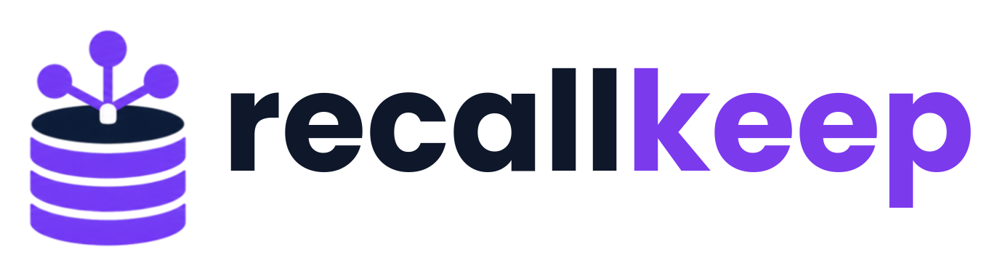

<p align="center">
  <picture>
    <source media="(prefers-color-scheme: dark)" srcset="docs/assets/logo-dark.png">
    <source media="(prefers-color-scheme: light)" srcset="docs/assets/logo-light.png">
    
  </picture>
</p>

<p align="center">
  <strong>Long-term memory for your AI coding agents. Self-hosted, and it works with the agent you already use.</strong>
</p>

<p align="center">
  <a href="https://github.com/theBlackEndDev/recallkeep/actions/workflows/ci.yml"></a>
  <a href="#license"></a>
  
  
  
</p>

<p align="center">
  <a href="#quickstart">Quickstart</a> •
  <a href="#connect-your-agent">Connect your agent</a> •
  <a href="#features">Features</a> •
  <a href="#how-it-works">How it works</a> •
  <a href="#words-youll-see">Glossary</a> •
  <a href="docs/">Docs</a>
</p>

Every time you start a new session, your coding agent has forgotten what you decided yesterday. You explain
the same rules again, and it reopens questions you already settled. RecallKeep fixes this. It keeps your
decisions, facts and past conversations in a Postgres database on your machine. It gives the relevant ones
back to the agent at the start of each session and with each prompt you send.

It works with any agent that supports MCP (Model Context Protocol, the standard way agents connect to
tools). It has ready-made hooks for **pi**, **Claude Code**, **OpenAI Codex CLI** and **Google Antigravity
CLI**. Several agents can share one memory, so a decision made in Claude Code is known in Codex too.

> **Status:** early (v0.1.0), and in daily use by its author since April 2026. Install it from this repo.
> It is not published to npm.

## Why

<table>
  <tr>
    <th width="50%">Without recallkeep</th>
    <th width="50%">With recallkeep</th>
  </tr>
  <tr>
    <td>Each session starts empty. You paste the same project rules again.</td>
    <td>Your standing rules and the project's locked decisions are in the agent's context before you type.</td>
  </tr>
  <tr>
    <td>The agent asks you to repeat what you said last week, or decides it again in a different way.</td>
    <td>The agent searches earlier sessions with <code>memory_search</code> and finds what was said.</td>
  </tr>
  <tr>
    <td>Notes are spread across CLAUDE.md, AGENTS.md and chat logs, a different file for each agent.</td>
    <td>One store, shared by every agent, with each fact filed under the project it belongs to.</td>
  </tr>
  <tr>
    <td>A hosted memory service keeps your code conversations on someone else's server.</td>
    <td>Everything stays in your own Postgres. With the <code>none</code> or <code>local</code> provider, nothing leaves your machine.</td>
  </tr>
</table>

## Features

- **Context at session start.** The agent gets your standing rules (for every project), the locked decisions
  for this project, and its newest facts.
- **Recall for each prompt.** Before the agent reads your prompt, RecallKeep adds the stored facts that best
  match it.
- **Agent tools.** `memory_search`, `memory_save`, `memory_context`, `memory_list` and `memory_forget` work in
  any MCP client.
- **Hybrid search.** Full-text search and semantic (vector) search are combined. Results are ranked by
  relevance, recency, tier and confidence.
- **Projects without setup.** The project comes from the folder you work in. `~/Projects/my-app/src` is
  `my-app`.
- **Conversation capture.** Each turn is logged. pi sessions are captured in full, including tool calls.
- **Secrets removed.** Captured conversations go through betterleaks or gitleaks plus a pattern check before
  they are stored.
- **Decisions layer.** An LLM pass picks out settled decisions from pi transcripts, so they are not reopened later.
- **Maintenance.** Session summaries, lesson extraction, promotion from short-term to long-term, conflict
  detection, export and backup.
- **Your choice of model.** OpenAI, Gemini, a local server such as Ollama, or no LLM at all.
- **Safe defaults.** The API listens on 127.0.0.1 only, rejects browser requests, and takes an optional
  bearer token.

## Before you start

You need:

- [Bun](https://bun.sh) 1.2 or newer.
- [Docker](https://docs.docker.com/get-docker/) to run Postgres with pgvector. Any Postgres 16 with the
  `vector` and `pg_trgm` extensions also works. Point `RECALLKEEP_DATABASE_URL` at it.
- Optional: an OpenAI or Gemini API key, or [Ollama](https://ollama.com), for semantic search and summaries.
  Without one, RecallKeep still works, and search uses full text and project tags.

## Quickstart

This setup uses no API key and makes no external calls. It takes about five minutes.

```bash
git clone https://github.com/theBlackEndDev/recallkeep.git
cd recallkeep
bun install
cp .env.example .env
echo 'RECALLKEEP_LLM_PROVIDER="none"' >> .env   # no LLM; change this later, see below

docker compose up -d                     # Postgres + pgvector on 127.0.0.1:5433
bunx prisma migrate deploy               # create the tables
bun run memory-api                       # the API on http://127.0.0.1:7775
```

Leave that running, and open a second terminal to check that it works:

```bash
curl -s http://127.0.0.1:7775/health
# {"status":"ok","backend":"recallkeep","port":7775}

curl -s -X POST http://127.0.0.1:7775/memory \
  -H 'Content-Type: application/json' \
  -d '{"content":"We deploy with blue-green releases.","project":"my-app","tags":["decision"]}'

bun run src/cli.ts recall --query "how do we deploy"
```

Next, [connect your agent](#connect-your-agent). To start RecallKeep at login, see
[Run it in the background](#run-it-in-the-background).

### Choose an LLM provider

The LLM computes embeddings for semantic search, and it writes summaries. Set `RECALLKEEP_LLM_PROVIDER` in `.env`:

| Provider | What you need | What leaves your machine |
|---|---|---|
| `none` | Nothing | Nothing. Search uses full text and project tags |
| `local` | Ollama or LM Studio on `localhost:11434` (`ollama pull nomic-embed-text` and `ollama pull llama3.2`) | Nothing |
| `openai` (default) | `OPENAI_API_KEY` | Text sent for embeddings and summaries |
| `gemini` | `GEMINI_API_KEY` | Text sent for embeddings and summaries |

Choose the embedding model before you store much data. Vectors from different models cannot be compared.
To fill in embeddings later, run `bun run src/cli.ts backfill`. Details:
[docs/configuration.md](docs/configuration.md).

## Connect your agent

Each agent gets two things:

1. **The MCP server** for the tools. The agent starts it with `bun /PATH/TO/recallkeep/src/cli.ts mcp`.
   The server talks to the API you started above.
2. **Hooks** for automatic memory: context at session start, recall on each prompt, and turn logging.
   Hooks fail open. If RecallKeep is down, the agent runs as normal.

In the commands below, replace `/PATH/TO/recallkeep` with the full path to your clone (run `pwd` inside it).
The MCP tools are the same in every agent:

| Tool | What it does |
|---|---|
| `memory_search` | Searches facts and past conversations. Defaults to the current project. `project: "all"` searches everything. |
| `memory_save` | Saves a fact. Tag it `decision` to show it at every session start. `project: "global"` makes it a rule for every project. |
| `memory_context` | Returns the session-start block on request, for clients without hooks. |
| `memory_list` | Lists a project's newest facts with their ids. |
| `memory_forget` | Archives a fact by id. Archived facts are kept but no longer recalled. |

### Claude Code

Verified with Claude Code 2.1.327.

```bash
claude mcp add recallkeep -s user -- bun /PATH/TO/recallkeep/src/cli.ts mcp
```

Copy the `hooks` block from [`integrations/claude-code/settings.json`](integrations/claude-code/settings.json)
into `~/.claude/settings.json` for all projects, or into `.claude/settings.json` for one project.

### OpenAI Codex CLI

Verified with Codex CLI 0.167.1.

Add [`integrations/codex/config.toml`](integrations/codex/config.toml) to `~/.codex/config.toml`. Codex asks you
to trust new hooks: open `/hooks` in Codex and approve the three RecallKeep hooks. In testing, Codex did not
load hooks from a project's `.codex/hooks.json`, but it did load the inline `[hooks]` tables in
`config.toml`.

### Google Antigravity CLI

Verified with `agy` 1.5.13. Antigravity CLI replaced Gemini CLI.

```bash
agy mcp add recallkeep bun /PATH/TO/recallkeep/src/cli.ts mcp
```

Copy [`integrations/antigravity/hooks.json`](integrations/antigravity/hooks.json) to `.agents/hooks.json` in your
workspace, or to `~/.gemini/config/hooks.json` for all workspaces. `agy` has no prompt-submit event, so the
recall hook runs on `PreInvocation`. RecallKeep looks up memory once per turn and reuses the result for the
other model calls in that turn.

### pi

pi gets a full extension. It injects context at session start, syncs the complete transcript (including tool
calls) after each turn, writes a handoff note when you quit, and adds the `memory_search` and `memory_save`
tools plus the `/memory` and `/handoff` commands.

```bash
mkdir -p ~/.pi/agent/extensions
cp -R /PATH/TO/recallkeep/integrations/pi ~/.pi/agent/extensions/memory
```

See [`integrations/pi/README.md`](integrations/pi/README.md). For the tools only, use
`pi mcp add recallkeep -- bun /PATH/TO/recallkeep/src/cli.ts mcp` instead.

### Any other MCP client

Cursor, Windsurf, Cline, VS Code and others can start the same server. Use command `bun` with arguments
`/PATH/TO/recallkeep/src/cli.ts mcp`. They get the tools but no hooks, so paste
[`integrations/AGENTS.md`](integrations/AGENTS.md) into your agent instructions. It tells the agent to call
`memory_context` at the start and to save decisions.

### Run it in the background

`scripts/start.sh` waits for Docker, starts Postgres, applies migrations and runs the API. Service templates
call it:

- **macOS:** [`deploy/launchd/dev.recallkeep.plist`](deploy/launchd/dev.recallkeep.plist)
- **Linux:** [`deploy/systemd/recallkeep.service`](deploy/systemd/recallkeep.service)

Each file explains in its header how to install it. To update later, run `bun run update`. It pulls,
installs, migrates and restarts the service.

## How it works

```text
 your agent ──hooks──▶ bun src/cli.ts hook ─┐
     │                                       ├──HTTP──▶ API server :7775 ──▶ Postgres + pgvector
     └──MCP────────▶ bun src/cli.ts mcp ────┘              │
                                                           └──▶ LLM provider (optional): embeddings, summaries
```

- **Facts** are short, curated statements: a decision, a rule, a finding. You or the agent save them.
- **Messages** are conversation turns captured by hooks. Long ones are split into chunks for search.
- **Recall** runs full-text and vector search, then ranks the results by relevance (60%), recency (15%), tier
  (15%) and confidence (10%). Facts from the current project get a boost.
- **Maintenance** (`bun run src/cli.ts maintain`, or `scripts/cron-maintain.sh`) moves short-term facts that
  were saved on purpose or have high confidence up to `DAILY` and then `LONG_TERM`. It archives the
  low-confidence short-term ones after 48 hours.

Full details: [docs/how-it-works.md](docs/how-it-works.md).

## Words you'll see

| Word | Meaning |
|---|---|
| **Fact** | One saved piece of knowledge, such as "We deploy with blue-green releases." |
| **Decision** | A fact tagged `decision`. It is shown at the start of every session in its project. |
| **Standing rule** | A fact saved under the project `global`. It is shown at the start of every session in every project. |
| **Project slug** | The project name, taken from your folder. `~/Projects/my-app/src` becomes `my-app`. |
| **Recall** | Finding the facts most relevant to a question and ranking them. |
| **Embedding** | A list of numbers that represents the meaning of a text. Texts with similar meanings get similar numbers. |
| **pgvector** | The Postgres extension that stores embeddings and finds similar ones. |
| **MCP** | Model Context Protocol, the standard way agents connect to tools. RecallKeep runs as an MCP server over stdio. |
| **Hook** | A command your agent runs at set moments, such as session start or prompt submit. |
| **Tier** | How long a fact lives: `SHORT_TERM`, `DAILY` or `LONG_TERM`. |

## Security and privacy

- The API listens on `127.0.0.1` only. To expose it on another address you must set `RECALLKEEP_API_TOKEN`, and
  clients then send `Authorization: Bearer <token>`.
- Browser requests are rejected, so a web page you visit cannot read your memory. To allow a specific origin,
  set `RECALLKEEP_CORS_ORIGINS`.
- Postgres is published on `127.0.0.1` only. Change `RECALLKEEP_DB_PASSWORD` before the first `docker compose up` if
  other people use your machine.
- Logged turns and pi transcripts are redacted before they are stored. Facts saved with `memory_save` are not
  redacted, so do not save secrets.

More: [docs/privacy.md](docs/privacy.md).

## Docs

| Document | Covers |
|---|---|
| [Configuration](docs/configuration.md) | Providers, embeddings, every environment variable |
| [CLI](docs/cli.md) | Every command: `recall`, `store`, `summarize`, `export`, `backup`, `mcp`, `hook` and more |
| [HTTP API](docs/api.md) | Every endpoint, with parameters and headers |
| [Capture](docs/capture.md) | How Claude Code, Codex, Antigravity and pi sessions are recorded |
| [How it works](docs/how-it-works.md) | Architecture, ranking, projects, decisions, summaries, tiers |
| [Privacy](docs/privacy.md) | What is stored, what is redacted, what leaves the machine |
| [Migration and updates](docs/migration.md) | Importing file-based memory, updating, backup and restore |
| [Development](docs/development.md) | Repo layout, programmatic API, tests, CI |

## Working on RecallKeep

```bash
bun install
bun run typecheck
bun test                 # unit tests; database tests are skipped
```

To run the database tests and the API contract smoke test, create a throwaway database. Never use the one
that holds your memory.

```bash
docker compose exec db createdb -U recallkeep recallkeep_test
export RECALLKEEP_TEST_DATABASE_URL="postgresql://recallkeep:<password>@localhost:5433/recallkeep_test"
RECALLKEEP_DATABASE_URL="$RECALLKEEP_TEST_DATABASE_URL" bunx prisma migrate deploy
bun test
SMOKE_DATABASE_URL="$RECALLKEEP_TEST_DATABASE_URL" bun run smoke
```

CI runs the same steps on every pull request. See [docs/development.md](docs/development.md).

## License

Apache-2.0. See [LICENSE](LICENSE).
